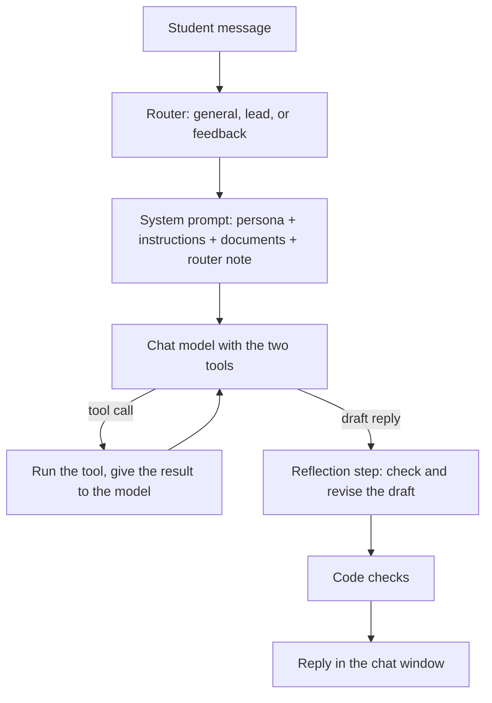

# CampusNest Assistant

An agent-powered business assistant for **CampusNest**, a student residence in Hamra, Beirut.

EECE 503P/798S: Agentic Systems. Assignment C3: Introduction to Agents.

> CampusNest is a fictional business. The names, prices, email address, and phone number are not real.

## What the chatbot does

- It answers questions about CampusNest. It uses a persona, a set of instructions, and two business documents.
- It sorts each message into one of three intents: `general`, `lead`, or `feedback` (router).
- It records leads: name, email, and a note (`record_customer_interest`).
- It records feedback and the questions that it cannot answer (`record_feedback`).
- It checks each draft reply before the student sees it, and it revises the reply if necessary (reflection step, bonus).
- It runs in a Gradio chat window, in the notebook or as a standalone app.

## Demo video

[Add the link to the demo video here.]

## Project structure

```
business_bot/
├── me/
│   ├── about_business.pdf      # Full business profile (the chatbot reads this file)
│   ├── about_business.md       # Source text of the PDF
│   └── business_summary.txt    # Short summary (the chatbot reads this file)
├── business_agent.ipynb        # Main chatbot code, with explanations and tests
├── app.py                      # Standalone Gradio app (made from the notebook)
├── build_app.py                # Makes app.py from the notebook
├── requirements.txt            # Python packages
├── .env                        # API key (not in Git)
└── logs/                       # Leads, feedback, and reflection logs (not in Git)
```

## Setup

Use Python 3.11.

1. Make a virtual environment and install the packages:
   ```bash
   python3 -m venv .venv
   source .venv/bin/activate
   pip install -r requirements.txt
   ```
2. Make a file with the name `.env` in the project folder. Write your OpenAI API key in it:
   ```
   OPENAI_API_KEY=your-key-here
   ```
   Do not put the `.env` file in Git. The `.gitignore` file prevents this.

## Run the chatbot

**In the notebook:** Open `business_agent.ipynb`, select the `.venv` kernel, and click **Run All**. The last code cell opens the chat window in the web browser.

**As a standalone app:**
```bash
source .venv/bin/activate
python app.py
```
The chat window opens at a local address, for example `http://127.0.0.1:7860`. To stop the app, push **Ctrl+C**.

**After a change in the notebook,** make `app.py` again:
```bash
python build_app.py
```
Do not edit `app.py` by hand.

## How the chatbot answers a message



## Notebook sections

| Section | Content |
|---|---|
| 1. Setup | OpenAI client, models, prices, cost log, `generate()` with a fallback model |
| 2. Load the business documents | `business_summary.txt` and the text of `about_business.pdf` |
| 3. Persona | `PERSONA`: who the assistant is, the tone, and the style |
| 4. Instructions | `INSTRUCTIONS`: 13 rules in 5 groups (answers, unknown questions, leads, feedback, character) |
| 5. Tools | The two tools, their MCP-style schemas, and a test |
| 6. Router | `route()`: keyword rules first, then a short model call, and a test |
| 7. System prompt | `system_prompt` and `build_system_prompt(intent)`, and a check |
| 8. Reflection step (bonus) | `reflect()`: checks each draft reply, and a test |
| 9. Chat function | `chat()`: the agent loop with short-term memory, and a conversation test |
| 10. Chat window | Gradio `ChatInterface` |
| 11. Standalone app | How `app.py` and `build_app.py` work |

## Persona and instructions

The persona and the instructions are in two separate, labeled cells (sections 3 and 4).

- **Persona:** "You are the CampusNest assistant." It sets a friendly, short, and clear style.
- **Instructions:** the rules that the model must obey. For example: use only facts from the documents, never confirm that a room is available, record unknown questions, and ask for the name and the email of a student who wants a viewing.

## Router

The router sorts each message before the chat model answers.

| Intent | Meaning | Example |
|---|---|---|
| `general` | A question about CampusNest | "How much is a studio?" |
| `lead` | The student wants a room or a viewing, or gives contact details | "Can I book a viewing?" |
| `feedback` | A complaint, a problem report, or a suggestion | "The Wi-Fi is down." |

1. Keyword rules decide the intent if the message has a clear word, for example "viewing" or "not working". This step costs nothing.
2. If no keyword matches, a short model call (`gpt-4.1-nano`, temperature 0, strict JSON schema) decides the intent. It also reads the last four messages.
3. Each intent adds its own instruction to the end of the system prompt.

## Tools

| Tool | Parameters | Output | Log file |
|---|---|---|---|
| `record_customer_interest(email, name, message)` | `email` (required), `name` (required), `message` (optional) | `recorded`, `updated`, `duplicate`, or `error` | `logs/leads.jsonl` |
| `record_feedback(question)` | `question` (required) | `recorded` | `logs/feedback.jsonl` |

- The lead tool rejects an email that has a bad format.
- The lead tool does not record the same email two times. If a recorded student gives new details, the tool adds them to the existing lead.
- Each tool prints one log line, for example `[LEAD]` or `[FEEDBACK]`.

The notebook documents each tool in MCP style: name, description, input schema, and output schema.

## Reflection step (bonus)

Before the student sees a reply, a second model call (`gpt-4.1-mini`) checks the draft against the documents and the rules:

1. Each fact must be in the documents. For an unknown topic, the reply must say "I do not have this information".
2. The reply must not confirm that a room is available.
3. Viewing times must be Monday to Saturday, 10:00 to 18:00.
4. The reply must not say "the documents" or show a tool name.

If the draft has a problem, the check writes a revised reply. The code prints the draft, the problems, and the revised reply, and writes them to `logs/reflection.jsonl`. Example:

```
[REFLECTION] Problems: ['The documents do not mention pets, ...']
[REFLECTION] DRAFT:   Sorry, pets are not allowed at CampusNest.
[REFLECTION] REVISED: I do not have this information, but the team will follow up on your question about pets.
```

## Checks in the code

Tests showed that the model does not always obey the instructions. These checks in the code make the important behavior reliable:

| Check | What the code does |
|---|---|
| Forced feedback tool | For a `feedback` message, the first model call must call `record_feedback`. |
| Promise check | If a reply says that the team will follow up, but no question was recorded, the code records the question. |
| Availability guard | The code does not record a question about availability as an unknown question. |
| Viewing hours | The code finds times outside the viewing hours, for example "9 am" or "Sunday". |
| Repeated offer | After the first request for the email, the code removes repeated requests, except when the student talks about booking. |

The code also ends each reply with "Is there anything else you would like to know?", except after a goodbye.

## Chat window

- White background, simple layout.
- The assistant's messages are light blue. The student's messages are gray.
- A copy button for each message.
- No undo button and no retry button. A retry records the same data two times.
- The window does not send an empty message.
- After each reply, the cursor goes back to the text box.

## Models and cost

| Job | Model | Fallback model |
|---|---|---|
| Replies and tool calls | `gpt-4o-mini` | `gpt-4.1-mini` |
| Router | `gpt-4.1-nano` | `gpt-4o-mini` |
| Reflection step | `gpt-4.1-mini` | `gpt-4o-mini` |

One message costs approximately $0.001. Each model call prints its tokens and its cost, for example `[USAGE] gpt-4o-mini: in=3031 (cached 2944) out=27 cost=$0.00025`. The system prompt is the same at the start of each call, so OpenAI keeps it in a cache, and the cached part costs 75% less.

Set `RUN_API_TESTS = False` in the setup cell to skip the tests that call the model. Then "Run All" costs nothing. Set `USE_REFLECTION = False` to skip the reflection step.

## Tests

The notebook has five test cells. The tests that call the model use separate test log files, so the real logs do not change.

| Test | Content | Result |
|---|---|---|
| Tools | 5 direct calls: new lead, update, duplicate, bad email, feedback | 5/5 |
| Router | 8 messages with known intents | 8/8 |
| System prompt | 5 requirements of the assignment, without a model call | 5/5 |
| Reflection step | 1 correct draft and 3 drafts with a problem | 4/4 |
| Conversation | 7 messages, with checks of the log files after each reply | 7/7 |

## Note about the API

The assignment refers to `openai.ChatCompletion`. The current `openai` package does not have this interface. This project uses its replacement, `client.chat.completions.create`.
