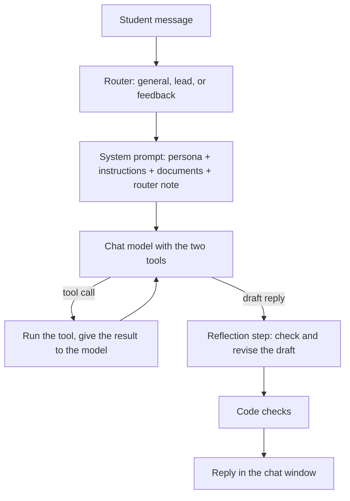
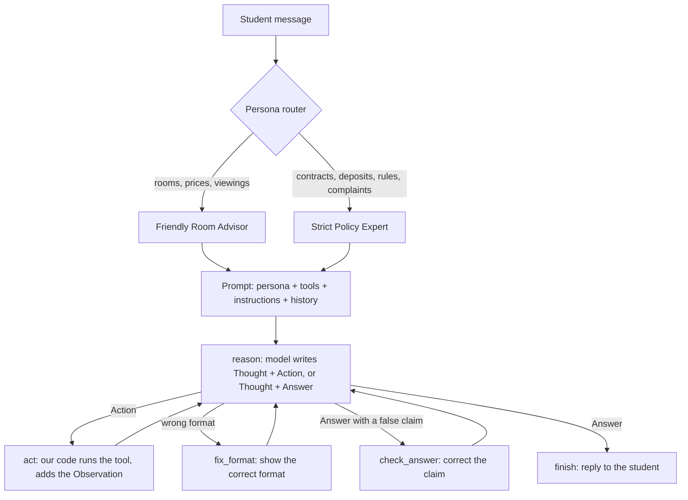

# CampusNest Assistant

An agent-powered business assistant for **CampusNest**, a student residence in Hamra, Beirut.

EECE 503P/798S: Agentic Systems. Assignment C3: Introduction to Agents.

> CampusNest is a fictional business. The names, prices, email address, and phone number are not real.

## What the chatbot does

- It answers questions about CampusNest. It uses a persona, a set of instructions, and two business documents.
- It sorts each message into one of three intents: `general`, `lead`, or `feedback` (router).
- It records leads: name, email, and a note (`record_customer_interest`).
- It records feedback and the questions that it cannot answer (`record_feedback`).
- It checks each draft reply before the student sees it, and it revises the reply if necessary (reflection step, bonus).
- It runs in a Gradio chat window, in the notebook or as a standalone app.

## Demo video

[Add the link to the demo video here.]

## Project structure

```
business_bot/
├── me/
│   ├── about_business.pdf      # Full business profile (the chatbot reads this file)
│   ├── about_business.md       # Source text of the PDF
│   └── business_summary.txt    # Short summary (the chatbot reads this file)
├── business_agent.ipynb        # C3: main chatbot code, with explanations and tests
├── react_agent.ipynb           # C4: ReAct agent with two personas, experiments and reflection
├── app.py                      # Standalone Gradio app (made from the notebook)
├── build_app.py                # Makes app.py from the notebook
├── requirements.txt            # Python packages
├── .env                        # API key (not in Git)
└── logs/                       # Leads, feedback, reflection logs, and the C4 experiment log (not in Git)
```

## Setup

Use Python 3.11.

1. Make a virtual environment and install the packages:
   ```bash
   python3 -m venv .venv
   source .venv/bin/activate
   pip install -r requirements.txt
   ```
2. Make a file with the name `.env` in the project folder. Write your OpenAI API key in it:
   ```
   OPENAI_API_KEY=your-key-here
   ```
   Do not put the `.env` file in Git. The `.gitignore` file prevents this.

## Run the chatbot

**In the notebook:** Open `business_agent.ipynb`, select the `.venv` kernel, and click **Run All**. The last code cell opens the chat window in the web browser.

**As a standalone app:**
```bash
source .venv/bin/activate
python app.py
```
The chat window opens at a local address, for example `http://127.0.0.1:7860`. To stop the app, push **Ctrl+C**.

**After a change in the notebook,** make `app.py` again:
```bash
python build_app.py
```
Do not edit `app.py` by hand.

## How the chatbot answers a message



## Notebook sections

| Section | Content |
|---|---|
| 1. Setup | OpenAI client, models, prices, cost log, `generate()` with a fallback model |
| 2. Load the business documents | `business_summary.txt` and the text of `about_business.pdf` |
| 3. Persona | `PERSONA`: who the assistant is, the tone, and the style |
| 4. Instructions | `INSTRUCTIONS`: 13 rules in 5 groups (answers, unknown questions, leads, feedback, character) |
| 5. Tools | The two tools, their MCP-style schemas, and a test |
| 6. Router | `route()`: keyword rules first, then a short model call, and a test |
| 7. System prompt | `system_prompt` and `build_system_prompt(intent)`, and a check |
| 8. Reflection step (bonus) | `reflect()`: checks each draft reply, and a test |
| 9. Chat function | `chat()`: the agent loop with short-term memory, and a conversation test |
| 10. Chat window | Gradio `ChatInterface` |
| 11. Standalone app | How `app.py` and `build_app.py` work |

## Persona and instructions

The persona and the instructions are in two separate, labeled cells (sections 3 and 4).

- **Persona:** "You are the CampusNest assistant." It sets a friendly, short, and clear style.
- **Instructions:** the rules that the model must obey. For example: use only facts from the documents, never confirm that a room is available, record unknown questions, and ask for the name and the email of a student who wants a viewing.

## Router

The router sorts each message before the chat model answers.

| Intent | Meaning | Example |
|---|---|---|
| `general` | A question about CampusNest | "How much is a studio?" |
| `lead` | The student wants a room or a viewing, or gives contact details | "Can I book a viewing?" |
| `feedback` | A complaint, a problem report, or a suggestion | "The Wi-Fi is down." |

1. Keyword rules decide the intent if the message has a clear word, for example "viewing" or "not working". This step costs nothing.
2. If no keyword matches, a short model call (`gpt-4o-mini`, temperature 0, strict JSON schema) decides the intent. It also reads the last four messages.
3. Each intent adds its own instruction to the end of the system prompt.

## Tools

| Tool | Parameters | Output | Log file |
|---|---|---|---|
| `record_customer_interest(email, name, message)` | `email` (required), `name` (required), `message` (optional) | `recorded`, `updated`, `duplicate`, or `error` | `logs/leads.jsonl` |
| `record_feedback(question)` | `question` (required) | `recorded` | `logs/feedback.jsonl` |

- The lead tool rejects an email that has a bad format.
- The lead tool does not record the same email two times. If a recorded student gives new details, the tool adds them to the existing lead.
- Each tool prints one log line, for example `[LEAD]` or `[FEEDBACK]`.

The notebook documents each tool in MCP style: name, description, input schema, and output schema.

## Reflection step (bonus)

Before the student sees a reply, a second model call (`gpt-4.1-mini`) checks the draft against the documents and the rules:

1. Each fact must be in the documents. For an unknown topic, the reply must say "I do not have this information".
2. The reply must not confirm that a room is available.
3. Viewing times must be Monday to Saturday, 10:00 to 18:00.
4. The reply must not say "the documents" or show a tool name.

If the draft has a problem, the check writes a revised reply. The code prints the draft, the problems, and the revised reply, and writes them to `logs/reflection.jsonl`. Example:

```
[REFLECTION] Problems: ['The documents do not mention pets, ...']
[REFLECTION] DRAFT:   Sorry, pets are not allowed at CampusNest.
[REFLECTION] REVISED: I do not have this information, but the team will follow up on your question about pets.
```

## Checks in the code

Tests showed that the model does not always obey the instructions. These checks in the code make the important behavior reliable:

| Check | What the code does |
|---|---|
| Forced feedback tool | For a `feedback` message, the first model call must call `record_feedback`. |
| Promise check | If a reply says that the team will follow up, but no question was recorded, the code records the question. |
| Availability guard | The code does not record a question about availability as an unknown question. |
| Viewing hours | The code finds times outside the viewing hours, for example "9 am" or "Sunday". |
| Repeated offer | After the first request for the email, the code removes repeated requests, except when the student talks about booking. |

The code also ends a reply with "Is there anything else you would like to know?", at most one time in three replies, and not after a goodbye.

## Chat window

- White background, simple layout.
- The assistant's messages are light blue. The student's messages are gray.
- A copy button for each message.
- No undo button and no retry button. A retry records the same data two times.
- The window does not send an empty message.
- After each reply, the cursor goes back to the text box.

## Models and cost

| Job | Model | Fallback model |
|---|---|---|
| Replies and tool calls | `gpt-4o-mini` | `gpt-4.1-mini` |
| Router | `gpt-4o-mini` (before: `gpt-4.1-nano`, retired by OpenAI on 2026-10-23) | `gpt-4.1-mini` |
| Reflection step | `gpt-4.1-mini` | `gpt-4o-mini` |

One message costs approximately $0.001. Each model call prints its tokens and its cost, for example `[USAGE] gpt-4o-mini: in=3031 (cached 2944) out=27 cost=$0.00025`. The system prompt is the same at the start of each call, so OpenAI keeps it in a cache, and the cached part costs 75% less.

Set `RUN_API_TESTS = False` in the setup cell to skip the tests that call the model. Then "Run All" costs nothing. Set `USE_REFLECTION = False` to skip the reflection step.

## Tests

The notebook has five test cells. The tests that call the model use separate test log files, so the real logs do not change.

| Test | Content | Result |
|---|---|---|
| Tools | 5 direct calls: new lead, update, duplicate, bad email, feedback | 5/5 |
| Router | 8 messages with known intents | 8/8 |
| System prompt | 5 requirements of the assignment, without a model call | 5/5 |
| Reflection step | 1 correct draft and 3 drafts with a problem | 4/4 |
| Conversation | 7 messages, with checks of the log files after each reply | 7/7 |

## Note about the API

The assignment refers to `openai.ChatCompletion`. The current `openai` package does not have this interface. This project uses its replacement, `client.chat.completions.create`.

---

## C4: ReAct Agent with Configurable Personas

EECE 503P/798S: Agentic Systems. Assignment C4: Agent Personas and Thinking Mechanisms. Notebook: `react_agent.ipynb`.

C4 extends the C3 chatbot into a ReAct agent in **LangGraph**, with a ReAct loop that we wrote ourselves, two personas with their own prompts and LLM settings, and logged experiments that compare prompt styles and settings.

### Builds on C3

In C3, the CampusNest chatbot used the OpenAI tool-calling API, a router, two tools, a reflection step, and a Gradio window. C4 keeps the business documents, the two record tools and the window style, and changes the rest:

| | C3 | C4 |
|---|---|---|
| Agent loop | OpenAI tool-calling API | **ReAct loop in LangGraph**: our parser reads `Thought / Action / Action Input / Answer` |
| Business facts | Full documents in the system prompt | **Only from tools**: the agent must look up each fact |
| Tools | 2 (record) | **6**: 4 look-up and check tools + the 2 C3 record tools |
| Personas | 1 | **2**, each with its own prompt and LLM settings |
| Router | Intent: general / lead / feedback | **Persona router**: sends each message to the agent whose task matches it |
| Evaluation | Test cells | **176 logged experiment runs**, comparison tables, chart, reflection |


### Run

The setup is the same as for C3 (see Setup above): `requirements.txt` also installs LangGraph, pandas and matplotlib.


Open `react_agent.ipynb`, select the `.venv` kernel, and click **Run All**.

- All outputs (tables, chart, examples, reflection) are saved in the notebook, so you can read the results without a new run.
- If the experiment log `logs/c4_runs.jsonl` exists and `RUN_EXPERIMENTS = False` (section 2), section 11 loads it. If the file does not exist, or `RUN_EXPERIMENTS = True`, section 11 runs all 176 experiments again (about 2-3 minutes) and writes a new log; some numbers can then differ slightly from the reflection.
- The last cell opens the chat window in the web browser, for example at `http://127.0.0.1:7860`.

### How the agent answers a message



- **Detect an action:** `parse_step()` reads each model output: `action`, `answer`, or `error`. It accepts `Action:` + `Action Input: {...}` and the short style `Action: tool("text")`.
- **Stop sequence `Observation:`:** the model stops after the Action Input, so it cannot invent an observation. Only our code writes observations.
- **Guards:** at most 6 model calls for each message, an error observation for an unknown tool or a wrong input, and a format reminder after each observation.
- **Answer check (working assistant only):** before an answer goes to the student, the code compares its claims with the tools that the agent called in this turn. "I will record your question" without a record tool, or "your viewing is all set", goes back to the model for a correction. This check was added after a manual test, after the experiments, so the experiments measure the agent without it.
- We do not use a prebuilt agent (`create_react_agent`, `AgentExecutor`).

### Personas

| | Friendly Room Advisor | Strict Policy Expert |
|---|---|---|
| Task | Help new students choose a room and book a viewing | Exact answers about contracts, payments, deposits, rules; record complaints |
| Tone | Warm, relaxed, like a senior student | Formal, neutral, precise; no small talk |
| Style | 2-4 sentences, one next step, at most one emoji | Direct answer, bullet list, policy section in brackets |
| Model | `gpt-4o-mini` | `gpt-4.1-mini` |
| Temperature | 0.7 (varied, natural wording) | 0.1 (almost the same answer every time) |
| Top-p | 0.9 | 0.5 |
| Frequency / presence penalty | 0.2 / 0.3 (fewer repeats, new suggestions) | 0.0 / 0.0 (exact terms may repeat; no new topics) |
| Max tokens | 350 | 300 |

The notebook gives a reason for each setting (section 5). The OpenAI API has no **top-k** setting, so the experiments test top-p.

### Tools

| Tool | Purpose |
|---|---|
| `search_documents(query)` | The 2 best matching parts of the business documents |
| `get_room_info(room_type)` | Price, size, bathroom, floors, number of rooms |
| `calculate_cost(room_type, pay_upfront, semesters)` | Rent, 5% upfront discount, deposit, amount due at signing |
| `check_viewing_slot(day, time)` | Is the time in the viewing hours (Monday to Saturday, 10:00-18:00)? |
| `record_customer_interest(email, name, message)` | Record a lead (from C3) |
| `record_feedback(question)` | Record an unknown question or a complaint (from C3) |

### Experiments

8 test questions with automatic checks (the checks look at the answer **and** at the tools that the agent used and the records that it wrote), 11 setups, 2 personas: **176 runs**. Each setup changes one thing from the baseline: no Chain-of-Thought, zero-shot, instructions in the message, temperature 0 and 1.2, top-p 0.3, penalties 1.0, max tokens 80, `gpt-4.1-nano`, and the model of the other persona. A judge model also scores each answer for persona fit and helpfulness (1-5).

> OpenAI retires `gpt-4.1-nano` on 2026-10-23. The saved `model_nano` results come from a run before that date. In a new run after that date, this setup gives errors; the notebook reports them and leaves them out of the tables.

Main results:

- **Strict Policy Expert:** 8/8 at baseline, and 8/8 in 8 of the 11 setups.
- **Friendly Room Advisor:** 7/8 at baseline. Its casual style leaves out that "only the office" can confirm availability.
- **The model and the prompt structure changed the results; the sampling settings did not.** Temperature, top-p, penalties and max tokens did not change the pass rate of either persona, because the facts come from the tools.
- **Zero-shot and `gpt-4.1-nano`** sometimes said "I will record your question" without the tool call.
- 0 tool errors and 0 runs at the step limit in all 176 runs.

The full tables, a chart, examples and the answers to the reflection questions are in sections 11 and 12 of the notebook.

### Chat window

The same window as in C3 (teal header, fact chips, example questions, no undo and retry buttons). The persona router chooses the agent for each message (keywords first, then a short `gpt-4o-mini` call that also reads the last four messages; router test 12/12), and a note under each reply shows which agent answered. The cell output shows the router decision and the full ReAct trace of each message.
