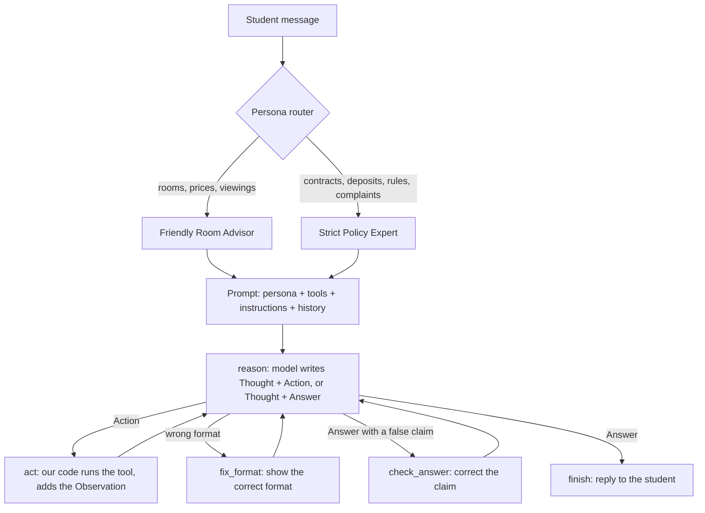

# CampusNest ReAct Agent with Configurable Personas

EECE 503P/798S: Agentic Systems. Assignment C4: Agent Personas and Thinking Mechanisms.

A ReAct agent for **CampusNest**, a student residence in Hamra, Beirut. It is built in **LangGraph**, with a ReAct loop that we wrote ourselves, two personas with their own prompts and LLM settings, and logged experiments that compare prompt styles and settings.

> CampusNest is a fictional business. The names, prices, email address, and phone number are not real.

## Builds on C3

In C3, the CampusNest chatbot used the OpenAI tool-calling API, a router, two tools, a reflection step, and a Gradio window. C4 keeps the business documents, the two record tools and the window style, and changes the rest:

| | C3 | C4 |
|---|---|---|
| Agent loop | OpenAI tool-calling API | **ReAct loop in LangGraph**: our parser reads `Thought / Action / Action Input / Answer` |
| Business facts | Full documents in the system prompt | **Only from tools**: the agent must look up each fact |
| Tools | 2 (record) | **6**: 4 look-up and check tools + the 2 C3 record tools |
| Personas | 1 | **2**, each with its own prompt and LLM settings |
| Router | Intent: general / lead / feedback | **Persona router**: sends each message to the agent whose task matches it |
| Evaluation | Test cells | **176 logged experiment runs**, comparison tables, chart, reflection |

## Files

```
├── react_agent.ipynb      # The C4 notebook: code, explanations, results, reflection
├── me/
│   ├── about_business.pdf     # Full business profile (the tools search this file)
│   └── business_summary.txt   # Short summary
├── results/
│   ├── c4_runs.jsonl          # All 176 experiment runs, with the full ReAct traces
│   ├── c4_summary.csv         # Results for each persona and setup
│   └── c4_chart.png           # Chart of the results
├── requirements.txt
└── .env.example           # Copy to .env and add your OpenAI API key
```

## Setup

Use Python 3.10 or later.

1. Make a virtual environment and install the packages:
   ```bash
   python -m venv .venv
   .venv\Scripts\activate        # Windows
   source .venv/bin/activate     # macOS / Linux
   pip install -r requirements.txt ipykernel
   ```
2. Copy `.env.example` to `.env`, and write your OpenAI API key in it:
   ```
   OPENAI_API_KEY=your-key-here
   ```

## Run

Open `react_agent.ipynb`, select the `.venv` kernel, and click **Run All**.

- All outputs (tables, chart, examples, reflection) are saved in the notebook, so you can read the results without a new run.
- If `results/c4_runs.jsonl` exists and `RUN_EXPERIMENTS = False` (section 2), section 11 loads the saved results. If the file does not exist, or `RUN_EXPERIMENTS = True`, section 11 runs all 176 experiments again (about 2-3 minutes); some numbers can then differ slightly from the reflection.
- The last cell opens the chat window in the web browser, for example at `http://127.0.0.1:7860`.

## How the agent answers a message



- **Detect an action:** `parse_step()` reads each model output: `action`, `answer`, or `error`. It accepts `Action:` + `Action Input: {...}` and the short style `Action: tool("text")`.
- **Stop sequence `Observation:`:** the model stops after the Action Input, so it cannot invent an observation. Only our code writes observations.
- **Guards:** at most 6 model calls for each message, an error observation for an unknown tool or a wrong input, and a format reminder after each observation.
- **Answer check (working assistant only):** before an answer goes to the student, the code compares its claims with the tools that the agent called in this turn. "I will record your question" without a record tool, or "your viewing is all set", goes back to the model for a correction. This check was added after a manual test, after the experiments, so the experiments measure the agent without it.
- We do not use a prebuilt agent (`create_react_agent`, `AgentExecutor`).

## Personas

| | Friendly Room Advisor | Strict Policy Expert |
|---|---|---|
| Task | Help new students choose a room and book a viewing | Exact answers about contracts, payments, deposits, rules; record complaints |
| Tone | Warm, relaxed, like a senior student | Formal, neutral, precise; no small talk |
| Style | 2-4 sentences, one next step, at most one emoji | Direct answer, bullet list, policy section in brackets |
| Model | `gpt-4o-mini` | `gpt-4.1-mini` |
| Temperature | 0.7 (varied, natural wording) | 0.1 (almost the same answer every time) |
| Top-p | 0.9 | 0.5 |
| Frequency / presence penalty | 0.2 / 0.3 (fewer repeats, new suggestions) | 0.0 / 0.0 (exact terms may repeat; no new topics) |
| Max tokens | 350 | 300 |

The notebook gives a reason for each setting (section 5). The OpenAI API has no **top-k** setting, so the experiments test top-p.

## Tools

| Tool | Purpose |
|---|---|
| `search_documents(query)` | The 2 best matching parts of the business documents |
| `get_room_info(room_type)` | Price, size, bathroom, floors, number of rooms |
| `calculate_cost(room_type, pay_upfront, semesters)` | Rent, 5% upfront discount, deposit, amount due at signing |
| `check_viewing_slot(day, time)` | Is the time in the viewing hours (Monday to Saturday, 10:00-18:00)? |
| `record_customer_interest(email, name, message)` | Record a lead (from C3) |
| `record_feedback(question)` | Record an unknown question or a complaint (from C3) |

## Experiments

8 test questions with automatic checks (the checks look at the answer **and** at the tools that the agent used and the records that it wrote), 11 setups, 2 personas: **176 runs**. Each setup changes one thing from the baseline: no Chain-of-Thought, zero-shot, instructions in the message, temperature 0 and 1.2, top-p 0.3, penalties 1.0, max tokens 80, `gpt-4.1-nano`, and the model of the other persona. A judge model also scores each answer for persona fit and helpfulness (1-5).

> OpenAI retires `gpt-4.1-nano` on 2026-10-23. The saved `model_nano` results come from a run before that date. In a new run after that date, this setup gives errors; the notebook reports them and leaves them out of the tables.

Main results:

- **Strict Policy Expert:** 8/8 at baseline, and 8/8 in 8 of the 11 setups.
- **Friendly Room Advisor:** 7/8 at baseline. Its casual style leaves out that "only the office" can confirm availability.
- **The model and the prompt structure changed the results; the sampling settings did not.** Temperature, top-p, penalties and max tokens did not change the pass rate of either persona, because the facts come from the tools.
- **Zero-shot and `gpt-4.1-nano`** sometimes said "I will record your question" without the tool call.
- 0 tool errors and 0 runs at the step limit in all 176 runs.

The full tables, a chart, examples and the answers to the reflection questions are in sections 11 and 12 of the notebook.

## Chat window

The same window as in C3 (teal header, fact chips, example questions, no undo and retry buttons). The persona router chooses the agent for each message (keywords first, then a short `gpt-4o-mini` call that also reads the last four messages; router test 12/12), and a note under each reply shows which agent answered. The cell output shows the router decision and the full ReAct trace of each message.
